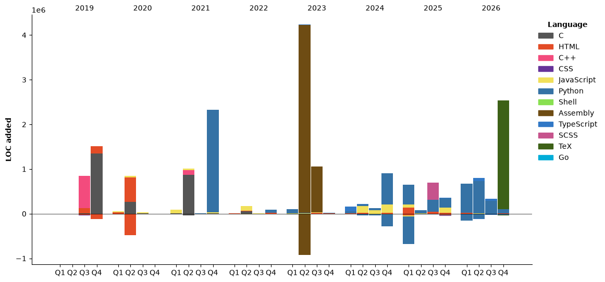

<!-- ================= HEADER BANNER ================= -->
<p align="center">
  
</p>

<p align="center">
  <a href="https://git.io/typing-svg">
    
  </a>
</p>

<p align="center">
  <a href="https://github.com/Ikaros-521/AI-Vtuber"></a>
  <a href="https://luoxiai.dpdns.org/"></a>
  <a href="https://space.bilibili.com/3709626"></a>
  <a href="https://ikaros-521.github.io/"></a>
</p>

---

### 💫 关于我 (About Me)

<table>
  <tr>
    <td width="66%" valign="top">
      <ul>
        <li>💻 <b>6+ 年软件工程沉淀</b>，聚焦于 <b>AI 应用研发、Agent 编排与数字人多模态交互系统</b>。</li>
        <li>🌟 核心开源项目 <b><a href="https://github.com/Ikaros-521/AI-Vtuber">AI-Vtuber</a></b> 主要开发与维护者，仓库斩获 <b>4.5k+ Stars</b>。</li>
        <li>🚀 个人商业产品 <b><a href="https://luoxiai.dpdns.org/">洛曦 AI</a></b> 独立开发者与运营者，拥有真实商业化落地与运行验证。</li>
        <li>🛠️ 践行 <b>KISS 原则</b>，擅长大模型应用架构、向量检索 RAG、异步流控调度与全栈交付。</li>
        <li>🌱 坚持探索前沿技术，热衷于将 AI 与工程结合创造有趣而实用的工具。</li>
      </ul>
    </td>
    <td width="34%" align="center" valign="middle">
      
    </td>
  </tr>
</table>

---

### 🌟 核心项目与产品 (Featured Projects)

<div align="center">
  <table border="0">
    <tr>
      <td width="50%" align="center" valign="top">
        <a href="https://github.com/Ikaros-521/AI-Vtuber">
          
        </a>
        <br/>
        <p align="left">
          🤖 <b>AI-Vtuber 交互直播系统</b><br/>
          • 多平台弹幕捕获 · LLM 意图回复 · TTS/SVC 声音转换<br/>
          • 支持 OpenAI 规范/Gemini 等多模型热插拔适配<br/>
          • 驱动 LiveTalking / VTS / UE5 / OBS 实现自动化互动直播
        </p>
      </td>
      <td width="50%" align="center" valign="top">
        <a href="https://luoxiai.dpdns.org/">
          
        </a>
        <br/><br/>
        <a href="https://luoxiai.dpdns.org/">
          
        </a>
        <br/>
        <p align="left">
          🎙️ <b>洛曦 AI（无人 AI 数字人直播系统）</b><br/>
          • 自主开发与商业化运营的 AI 直播交付方案<br/>
          • 全天候低延迟多模态互动，支持真实商业落地环境<br/>
          • 🌐 官网入口：<a href="https://luoxiai.dpdns.org/">luoxiai.dpdns.org</a>
        </p>
      </td>
    </tr>
  </table>
</div>

---

### 🛠️ 技术专长 (Tech Stack)

<p align="center">
  
</p>

<details open>
<summary><b>🧩 核心领域与工程能力细分</b></summary>
<br/>

| 领域方向 | 重点技术与工程实践 |
| :--- | :--- |
| **🤖 智能体与模型工程** | `LangGraph (流程编排与状态流转)` · `Milvus (向量入库与混合检索)` · `RAG / 知识库检索` · `OpenAI API / Gemini` · `模型评测体系 (检索指标 / 质量 / 时延 / 成本)` |
| **🎙️ 音视频与多模态** | `TTS 语音合成` · `SVC 声音转换` · `ASR 语音转写与时间轴对齐` · `VLM 视觉事件检测` · `赛事高光拆条` · `计分板 OCR` |
| **⚡ 后端调度与高并发** | `Python (FastAPI / 异步多任务 / 信号量并发控制)` · `Docker 容器管理与 GPU 资源调度` · `MySQL` · `RabbitMQ 消息队列` · `线程池/异步缓存汇总` |
| **💻 Web 全栈与自动化** | `TypeScript` · `React` · `Next.js` · `Vue3` · `NestJS` · `Playwright / Browser-Use 自动化` · `n8n / Langflow` |
| **🔌 底层系统沉淀** | `C / C++` · `Linux 环境` · `TCP / UDP / 串口通信协议` · `嵌入式软硬件联动与上位机开发` |

</details>

---

### 📊 个人数据看板 (GitHub Metrics)

<p align="center">
  
</p>
<p align="center">
  
</p>

<p align="center">
  
</p>

<!--START_SECTION:waka-->


**🐱 My GitHub Data** 

> 📦 3.6 MB Used in GitHub's Storage 
 > 
> 🏆 719 Contributions in the Year 2026
 > 
> 🚫 Not Opted to Hire
 > 
> 📜 476 Public Repositories 
 > 
> 🔑 78 Private Repositories 
 > 
**I'm an Early 🐤** 

```text
🌞 Morning                1397 commits        ████░░░░░░░░░░░░░░░░░░░░░   17.69 % 
🌆 Daytime                3009 commits        ██████████░░░░░░░░░░░░░░░   38.11 % 
🌃 Evening                3208 commits        ██████████░░░░░░░░░░░░░░░   40.63 % 
🌙 Night                  281 commits         █░░░░░░░░░░░░░░░░░░░░░░░░   03.56 % 
```
📅 **I'm Most Productive on Wednesday** 

```text
Monday                   1090 commits        ███░░░░░░░░░░░░░░░░░░░░░░   13.81 % 
Tuesday                  1315 commits        ████░░░░░░░░░░░░░░░░░░░░░   16.66 % 
Wednesday                1437 commits        █████░░░░░░░░░░░░░░░░░░░░   18.20 % 
Thursday                 1197 commits        ████░░░░░░░░░░░░░░░░░░░░░   15.16 % 
Friday                   1311 commits        ████░░░░░░░░░░░░░░░░░░░░░   16.61 % 
Saturday                 740 commits         ██░░░░░░░░░░░░░░░░░░░░░░░   09.37 % 
Sunday                   805 commits         ███░░░░░░░░░░░░░░░░░░░░░░   10.20 % 
```


📊 **This Week I Spent My Time On** 

```text
🕑︎ Time Zone: Asia/Shanghai

💬 Programming Languages: 
Other                    3 hrs 5 mins        ███████░░░░░░░░░░░░░░░░░░   26.27 % 
Python                   2 hrs 55 mins       ██████░░░░░░░░░░░░░░░░░░░   24.86 % 
TypeScript               1 hr 42 mins        ████░░░░░░░░░░░░░░░░░░░░░   14.47 % 
Markdown                 1 hr 31 mins        ███░░░░░░░░░░░░░░░░░░░░░░   12.97 % 
JavaScript               1 hr 25 mins        ███░░░░░░░░░░░░░░░░░░░░░░   12.05 % 

🔥 Editors: 
Cursor                   11 hrs 12 mins      ████████████████████████░   94.97 % 
ZCode                    35 mins             █░░░░░░░░░░░░░░░░░░░░░░░░   05.03 % 

💻 Operating System: 
Windows                  11 hrs 48 mins      █████████████████████████   100.00 % 
```

🤖 **AI Coding This Week** 

```text
⏱ AI Coding Time: 11 hrs 45 mins (99.63%)

✍️ 9,252 lines written by AI, 1 lines written by hand (99.99% AI-written)

🔤 8,326,778 Input Tokens, 1,167,629 Output Tokens

💵 $1568.44 Estimated AI Cost This Week

🧠 17 AI Sessions, 81 AI Prompts

GLM                      9,252 lines         █████████████████████████   100.00 % 
Cursor                   0 lines             ░░░░░░░░░░░░░░░░░░░░░░░░░   00.00 % 
Gemini                   0 lines             ░░░░░░░░░░░░░░░░░░░░░░░░░   00.00 % 

🔎 AI Coding Insights:
🤖 AI-Driven — 99.99% of written lines came from AI
📝 Concise Prompter — average 79 characters per prompt
🔁 Iterative Prompter — average 5 prompts per session
🚀 High AI Trust — 0.01% of changed lines were hand-edited
```

**I Mostly Code in Python** 

```text
Python                   117 repos           ████████████░░░░░░░░░░░░░   48.35 % 
JavaScript               43 repos            ████░░░░░░░░░░░░░░░░░░░░░   17.77 % 
HTML                     19 repos            ██░░░░░░░░░░░░░░░░░░░░░░░   07.85 % 
PowerShell               1 repo              ░░░░░░░░░░░░░░░░░░░░░░░░░   00.41 % 
TeX                      1 repo              ░░░░░░░░░░░░░░░░░░░░░░░░░   00.41 % 
```


**Timeline**




<!--END_SECTION:waka-->

---

### 🌐 社交与博客 (Connect With Me)

<p align="center">
  <a href="https://ikaros-521.github.io/"></a>
  &nbsp;
  <a href="https://space.bilibili.com/3709626"></a>
  &nbsp;
  <a href="https://blog.csdn.net/Ikaros_521"></a>
  &nbsp;
  <a href="https://www.cnblogs.com/ikaros-521"></a>
  &nbsp;
  <a href="https://gitee.com/ikaros-521"></a>
</p>

<p align="center">
  
</p>
